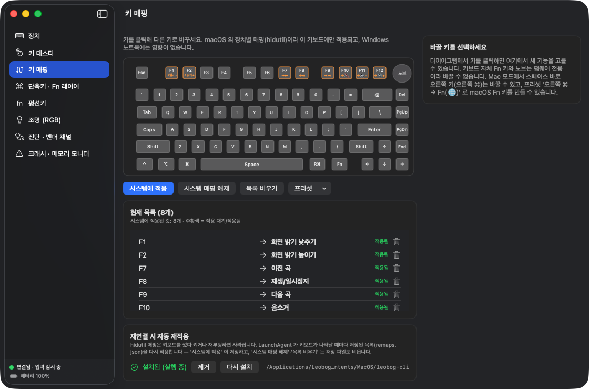
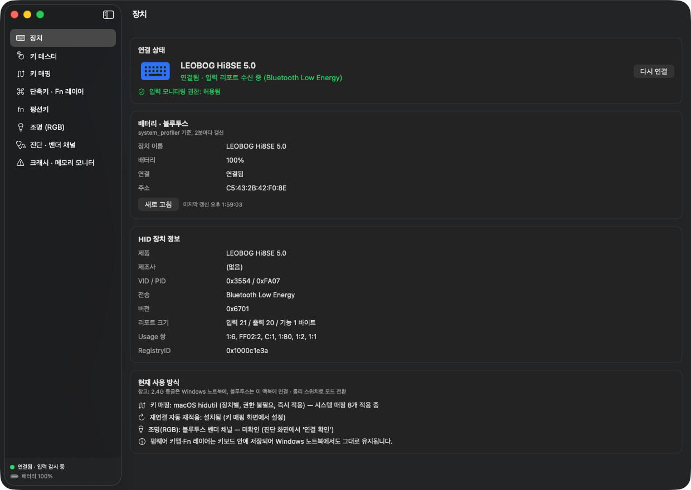
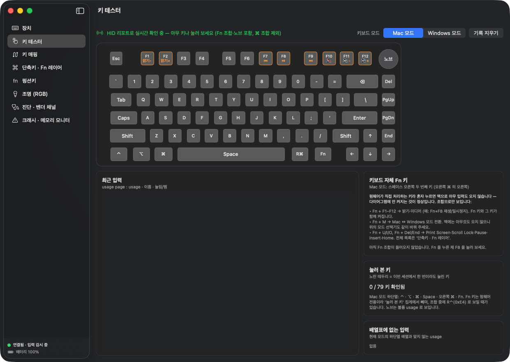
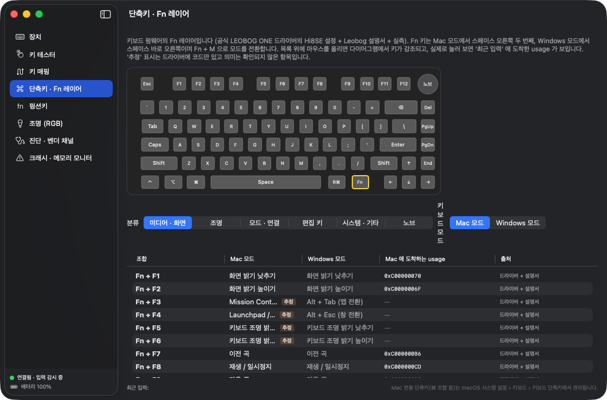
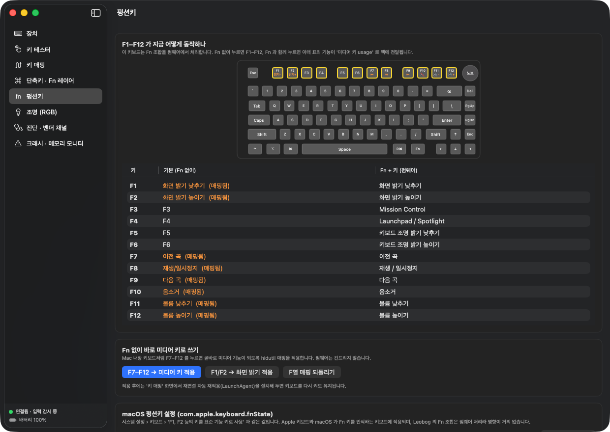
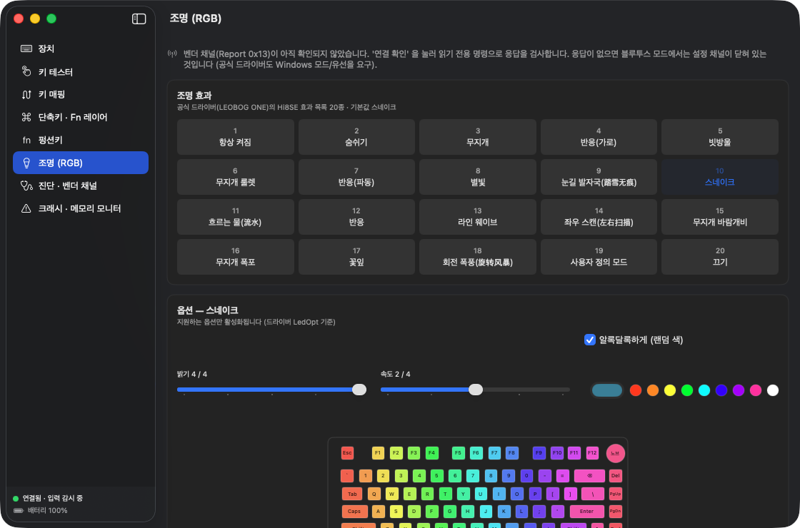
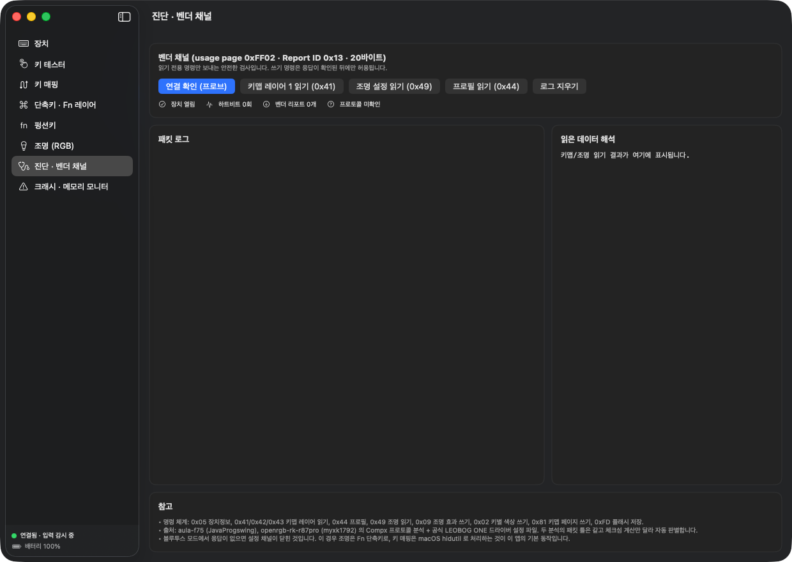

# Leobog Control

LEOBOG **Hi8SE** 키보드를 설정하는 비공식 도구입니다. **macOS 앱 + CLI** 와 **Windows 앱** 두 가지로 되어 있고, 키 매핑 저장 형식과 키보드 벤더 프로토콜 구현을 공유합니다.

공식 드라이버(LEOBOG ONE)는 Windows 전용이고 2.4G 동글/USB 에서만 동작합니다. 이 프로젝트는 그 빈자리 — 특히 **블루투스로 연결한 Mac** — 를 메우고, Windows 쪽에서도 공식 드라이버 없이 키 재배치·키 테스트·조명 설정을 할 수 있게 합니다.

| | macOS | Windows |
|---|---|---|
| 형태 | `Leobog Control.app` + `leobog-cli` | `LeobogControl.exe` 단일 실행 파일 |
| 연결 | Bluetooth (VID `0x3554` / PID `0xFA07`) | 2.4G 동글 / USB (VID `0x3554`) |
| 요구 사항 | macOS 14 이상, Apple Silicon | Windows 10 이상 (x64), 런타임 동봉 |
| 키 매핑 방식 | `hidutil` 장치별 매핑 (이 키보드에만 적용, 재연결 시 자동 재적용) | 레지스트리 `Scancode Map` (시스템 전체, 로그아웃 후 반영) |
| 키 테스터 | IOHIDManager (입력 모니터링 권한) | Raw Input (권한 불필요) |
| 조명 / 진단 | 벤더 채널 — **블루투스에서는 키보드가 응답하지 않음** | 벤더 채널 (동글/USB 에서 응답 시 동작) |

> **비공식 프로젝트입니다.** LEOBOG 와 무관하며, 벤더 프로토콜은 공개된 오픈소스 분석과 공식 드라이버의 설정 파일을 바탕으로 구현했습니다. 쓰기 명령(조명 적용·플래시 저장)은 키보드가 프로브에 응답한 뒤에만 보내도록 막아 두었지만, 사용에 따른 책임은 사용자에게 있습니다.

<p align="center"></p>
<p align="center"><sub>macOS 앱의 키 매핑 탭. 아래 스크린샷은 모두 블루투스로 연결한 Hi8SE 와 실제로 찍은 macOS 앱 화면입니다. (Windows 앱은 이 Mac 에서 실행할 수 없어 스크린샷이 없습니다.)</sub></p>

---

## 목차

1. [다운로드 · 설치](#1-다운로드--설치)
2. [macOS 앱](#2-macos-앱)
3. [macOS CLI](#3-macos-cli)
4. [Windows 앱](#4-windows-앱)
5. [키보드 모드와 하단열](#5-키보드-모드와-하단열)
6. [Fn 조합(단축키) 참고표](#6-fn-조합단축키-참고표)
7. [소스에서 빌드](#7-소스에서-빌드)
8. [배포(릴리스)](#8-배포릴리스)
9. [제거](#9-제거)
10. [문제 해결](#10-문제-해결)
11. [프로젝트 구조](#11-프로젝트-구조)
12. [참고 자료](#12-참고-자료)

---

## 1. 다운로드 · 설치

[Releases](../../releases) 페이지에서 받습니다. 각 릴리스에는 다음 세 파일이 있습니다.

| 파일 | 내용 |
|---|---|
| `LeobogControl-macOS-x.y.z.zip` | `Leobog Control.app` (앱 안에 `leobog-cli` 포함) |
| `LeobogControl-Windows-x.y.z.zip` | `LeobogControl.exe` (.NET 런타임 동봉, 설치 불필요) |
| `SHA256SUMS.txt` | 위 두 파일의 SHA-256 |

### macOS

1. zip 을 풀어 `Leobog Control.app` 을 `/Applications` 로 옮깁니다.
2. 앱은 **ad-hoc 서명**(Apple 공증 없음)이라 처음 열 때 Gatekeeper 가 막습니다. 앱을 **우클릭 → 열기** 하거나, 시스템 설정 → 개인정보 보호 및 보안 → "그래도 열기" 를 누릅니다. 터미널에서는 다음으로 격리 속성을 지울 수 있습니다.

```bash
xattr -dr com.apple.quarantine "/Applications/Leobog Control.app"
```

3. 첫 실행 시 **입력 모니터링** 권한을 요청합니다. 자세한 절차는 [2.1 첫 실행과 권한](#21-첫-실행과-권한) 을 보세요.

### Windows

1. zip 을 풀어 `LeobogControl.exe` 를 원하는 폴더에 둡니다. 설치 과정은 없습니다.
2. 코드 서명이 없어 SmartScreen 이 경고할 수 있습니다. "추가 정보 → 실행" 을 누릅니다.
3. 키보드는 **2.4G 동글 또는 USB 케이블**로 연결합니다. 블루투스로 연결한 키보드는 Windows 에서도 벤더 채널이 열리지 않으므로 조명·진단 탭은 쓸 수 없고, 키 테스터와 키 매핑만 동작합니다.
4. 키 매핑을 시스템에 적용할 때만 **관리자 권한(UAC)** 을 묻습니다. 그 외 기능은 일반 사용자 권한으로 동작합니다.

### 무결성 확인

```bash
shasum -a 256 -c SHA256SUMS.txt        # macOS
```

```powershell
Get-FileHash .\LeobogControl-Windows-1.0.0.zip -Algorithm SHA256   # Windows
```

---

## 2. macOS 앱

`/Applications/Leobog Control.app` (Spotlight 에서 "Leobog Control"). 번들 ID 는 `com.leobog.control` 입니다.

사용 환경 전제: 블루투스는 MacBook, 2.4G 동글은 Windows 쪽에 꽂아 두고, 키보드의 물리 스위치와 **Fn + M** 으로 모드를 바꿔 가며 씁니다.

### 2.1 첫 실행과 권한

1. 앱을 실행하면 **입력 모니터링** 권한을 요청합니다. 이 대화상자에는 **허용** 버튼이 없습니다. **시스템 설정 열기** 를 누르고 입력 모니터링 목록에서 `Leobog Control` 스위치를 켜면 몇 초 안에 앱이 장치를 다시 엽니다. 대화상자를 놓쳤으면 시스템 설정 → 개인정보 보호 및 보안 → 입력 모니터링 → `Leobog Control` 을 켠 뒤, 앱의 "장치" 탭에서 **권한 다시 확인** 을 누릅니다.
2. "장치" 탭에 **거부됨** 으로 보이면 macOS 가 이전 결정(거부, 또는 앱을 다시 빌드해서 무효가 된 허용)을 기억하고 있어 대화상자를 다시 띄우지 않는 것입니다. 이때 버튼은 **권한 기록 지우고 다시 요청** 으로 바뀌며, 누르면 기록을 지우고(`tccutil reset ListenEvent com.leobog.control`) 바로 다시 묻습니다.
3. 권한이 **없어도** 되는 기능: 장치 정보 · 배터리, **키 매핑**, 펑션키 설정, Fn 단축키 표, 키 테스터(앱 창이 맨 앞에 있을 때만).
4. 배터리 **직접 읽기**만 별도로 macOS 블루투스 권한을 쓴다 (장치 탭 버튼으로 처음 한 번 요청, 입력 모니터링과 무관).
4. 권한이 **필요한** 기능: 키 테스터의 HID 수준 감지(다른 앱이 앞에 있어도 감지), 진단 탭의 벤더 채널, 조명 탭의 "키보드에 적용".

### 2.2 탭별 기능

#### 장치



연결 상태, 배터리 잔량(macOS 시스템 정보 값 2분마다 갱신 + 앱이 BLE Battery Service 에서 직접 읽은 값 1분마다), HID 장치 정보(VID/PID, 리포트 크기, usage 쌍), 권한 상태. macOS 가 보여 주는 배터리 값은 연결 시점에 한 번 읽은 뒤 키보드가 알려 줄 때만 바뀌므로 100% 에 오래 머물 수 있다 — "직접 읽기 시작" 을 누르면(처음 한 번 블루투스 권한 대화상자) 앱이 키보드에서 실제 값을 읽어 온다.

#### 키 테스터



키보드 그림 위에서 지금 눌린 키가 켜지고, 최근 입력(usage 코드 포함)이 목록으로 쌓입니다. 노브 돌리기/누르기도 소비자(consumer) usage 로 잡힙니다. 매핑을 적용한 키는 주황색 테두리와 대상 키 라벨(넓은 키에서는 `→대상`)로 표시됩니다.

오른쪽 위 **키보드 모드** 선택기(Mac 모드 / Windows 모드)는 키보드 펌웨어 모드에 맞춰 하단열 그림을 바꿉니다 ([5. 키보드 모드와 하단열](#5-키보드-모드와-하단열)). "배열표에 없는 입력" 카드는 선택한 모드와 펌웨어 모드가 다를 때 쌓입니다.

#### 키 매핑


키보드 그림에서 키를 누르고 → 오른쪽 목록에서 대상 키를 고른 뒤 → **시스템에 적용**.

- 원리: macOS 내장 `hidutil` 의 장치 한정 `UserKeyMapping` 을 **VID/PID 로 이 키보드에만** 적용합니다. MacBook 내장 키보드나 다른 키보드에는 영향이 없습니다.
- 저장 위치: `~/Library/Application Support/LeobogControl/remaps.json` (Windows 앱과 같은 형식)
- 블루투스가 끊겼다 다시 붙으면 hidutil 매핑이 사라집니다. **"재연결 시 자동 재적용"** 을 켜면 LaunchAgent(`com.leobog.control.remap`)가 `leobog-cli watch` 를 띄워 두고 키보드가 다시 연결될 때마다 저장된 매핑을 다시 적용합니다. **"시스템에 적용"** 이 이 파일을 저장하고, **"시스템 매핑 해제"** 와 **"목록 비우기"** 는 저장 파일도 비웁니다 — 그래야 다음 재연결 때 방금 지운 매핑이 되살아나지 않습니다. LaunchAgent 는 `leobog-cli` 실행 파일이 있을 때만 유지되도록(`KeepAlive` → `PathState`) 등록되어, 앱을 지워도 launchd 가 없는 프로그램을 계속 재시작하려 들지 않습니다.

| 프리셋 | 내용 |
|---|---|
| `swap-cmd-opt` | Win ↔ Alt 교체 (Mac 모드에서는 펌웨어가 이미 바꿔 주므로 Windows 모드로 쓸 때만) |
| `caps-ctrl` | Caps Lock → Control |
| `caps-esc` | Caps Lock → Esc |
| `f-media` | F7–F12 → 이전곡 / 재생·일시정지 / 다음곡 / 음소거 / 볼륨 |
| `f-bright` | F1/F2 → 화면 밝기 |
| `rcmd-fn` | **Mac 모드**: 스페이스 바로 오른쪽 키(오른쪽 ⌘) → macOS Fn(🌐) 키 |
| `rctrl-fn` | **Windows 모드**: 스페이스 오른쪽 두 번째 키(오른쪽 Ctrl) → macOS Fn(🌐) 키 |
| `del-fwd` | 오른쪽 위 Del → Backspace |

#### 단축키 · Fn 레이어



키보드 펌웨어의 Fn 조합을 분류별로 보여 줍니다 ([6. Fn 조합 참고표](#6-fn-조합단축키-참고표)). 입력 모니터링 권한이 있으면 실제로 Mac 에 도착한 usage 와 대조해 ✓ 를 찍어 줍니다. "추정" 배지는 드라이버 기능 코드만 있고 의미를 확정하지 못한 항목입니다.

#### 펑션키



- **F1–F12 를 표준 기능 키로 사용** 토글: macOS 의 `com.apple.keyboard.fnState` 를 바꿉니다(시스템 설정 → 키보드의 같은 항목). 켜면 F 열이 항상 F1–F12 로 들어가고, 미디어 동작은 키보드 Fn 조합으로만 나갑니다.
- F 열 매핑 프리셋(`f-media`, `f-bright`)을 여기서도 바로 적용/해제할 수 있습니다.
- **macOS Fn(🌐) 키 만들기**: 키보드 자체 Fn 키는 펌웨어 전용이라 바꿀 수 없으므로, Mac 모드에서는 스페이스 바로 오른쪽 키(오른쪽 ⌘)를 macOS Fn/🌐 로 매핑하는 버튼(`rcmd-fn`)을 제공합니다. 받아쓰기·이모지·fn+화살표 등이 그 키로 동작하고, 키보드 Fn 조합은 그대로 유지됩니다.

#### 조명 (RGB)



20가지 효과(공식 드라이버 KB.ini 의 LedOpt 목록, 한국어 이름), 밝기/속도 0–4, 랜덤 색, 사용자 색, 프리셋 색을 고르고 **키보드에 적용** 을 누르면 벤더 채널(report `0x13`, Compx 계열 프로토콜)로 전송합니다.

> **블루투스에서는 동작하지 않습니다 (2026-10-19 실측).** 블루투스 모드의 키보드는 벤더 채널 조회(`0x05` 장치 정보)에 응답하지 않았습니다(3회 재시도 모두 시간 초과, 하트비트 없음). 앱은 안전장치로, 진단 탭의 "연결 확인" 에서 응답이 확인되기 전에는 조명 쓰기 명령을 보내지 않습니다.
>
> 지금 쓸 수 있는 방법: ① 키보드 자체 단축키(Fn + Tab 효과, Fn + ↑/↓ 밝기, Fn + ←/→ 속도, Fn + \ 색). ② 동글을 꽂은 Windows 쪽에서 이 프로젝트의 Windows 앱이나 공식 드라이버로 설정하면 키보드 내부에 저장되므로 블루투스 모드로 바꿔도 보통 유지됩니다. ③ 키보드를 USB 케이블이나 동글로 Mac 에 직접 연결한 뒤 진단 탭 → "연결 확인" 이 응답하면 조명 탭이 그대로 동작합니다.

#### 진단 · 벤더 채널



읽기 전용 명령(연결 확인 `0x05`, 키맵 레이어 읽기 `0x41`, 조명 읽기 `0x49`, 프로필 `0x44`)과 패킷 로그, 체크섬 방식 자동 감지 결과를 보여 줍니다.

#### 크래시 · 메모리 모니터
앱이 갑자기 종료됐을 때 **왜** 죽었는지 바로 볼 수 있는 화면입니다.
- `~/Library/Logs/DiagnosticReports/LeobogControl-*.ips` 를 읽어 종료 종류(EXC_BAD_ACCESS 같은 메모리 접근 오류 / SIGABRT / **jetsam = 메모리 부족으로 시스템이 종료**)와 죽은 스레드의 호출 스택을 요약합니다.
- 실행 중 메모리 사용량(footprint)과 시스템 메모리 압박 단계를 2초마다 보여 주고, `~/Library/Logs/LeobogControl/app.log` 의 동작 기록(화면 전환, 장치 연결/해제, 권한 변화, 종료)을 함께 보여 줍니다. 비정상 종료 뒤 다시 실행하면 "지난 실행이 비정상 종료됨" 배너가 뜹니다.
- 터미널에서는 `zsh scripts/crash-monitor.sh` 로 같은 내용을 요약할 수 있습니다.

---

## 3. macOS CLI

```bash
alias leobog='"/Applications/Leobog Control.app/Contents/MacOS/leobog-cli"'
```

| 명령 | 설명 |
|---|---|
| `leobog info` | HID 장치 정보 + 권한 상태 |
| `leobog battery` | 블루투스 배터리 잔량 |
| `leobog listen [초]` | 키 입력 / 벤더 리포트 실시간 출력 (입력 모니터링 권한 필요) |
| `leobog probe` | 벤더 채널 읽기 전용 프로브 |
| `leobog keymap list` | 저장된 매핑 + 시스템에 적용된 매핑 |
| `leobog keymap set caps lctrl` | 매핑 추가 (별칭 또는 `0x7000000xx` usage) |
| `leobog keymap remove caps` | 매핑 제거 |
| `leobog keymap apply` / `clear` | 저장된 매핑 적용 / 전부 해제 |
| `leobog keymap preset caps-esc` | 프리셋 적용 (`keymap presets` 로 목록) |
| `leobog watch` | 재연결 시 재적용 (LaunchAgent 가 사용) |
| `leobog fn get` / `fn set on\|off` | 표준 기능 키 설정 |
| `leobog led list` / `led read` / `led effect N [--brightness 0-4] [--speed 0-4] [--random] [--color RRGGBB]` | 조명 (벤더 채널 응답이 있을 때만) |

키 별칭: `caps esc tab space enter del bs lctrl lshift lalt lcmd rctrl … fn globe none f1–f24 play next prev mute volup voldown a–z 0–9`, 또는 `0x700000039` 형식.

---

## 4. Windows 앱

`LeobogControl.exe` 하나로 동작합니다 (.NET 7 WinForms, 런타임 동봉). 동글 또는 USB 로 연결한 키보드를 VID `0x3554` 로 찾습니다.

> 이 README 의 스크린샷은 모두 macOS 앱입니다. Windows 앱은 같은 탭 구성(장치 · 키 테스터 · 키 매핑 · 단축키 · 조명 · 진단)을 WinForms 로 옮긴 것으로, 화면 구성은 비슷하지만 생김새는 다릅니다.

### 4.1 macOS 버전과 다른 점

| 항목 | 내용 |
|---|---|
| 키 매핑 범위 | Windows 의 `Scancode Map` 은 **시스템 전체** 설정입니다. 연결된 모든 키보드(노트북 내장 키보드 포함)에 적용되고, **로그아웃 후 다시 로그인**해야 반영됩니다. |
| 관리자 권한 | `HKLM\SYSTEM\CurrentControlSet\Control\Keyboard Layout\Scancode Map` 에 쓰기 위해 적용/해제 때만 UAC 를 묻습니다. 앱이 `.reg` 파일을 만들고 `reg.exe import` 를 승격 실행합니다. UAC 를 취소하면 아무것도 바뀌지 않습니다. |
| 표현 불가 매핑 | 화면 밝기(`f-bright`), macOS Fn/🌐 (`rcmd-fn`, `rctrl-fn`)는 Scancode Map 으로 표현할 수 없어 프리셋 메뉴에서 "(macOS 전용)" 으로 비활성화되고, 목록에서는 **표현 불가** 로 표시되어 적용 시 제외됩니다. |
| 키 테스터 | Raw Input(`WM_INPUT`) 으로 받으므로 별도 권한이 없고, 장치 이름(`VID_3554`)으로 이 키보드의 입력만 구분합니다. 다만 Scancode Map 이 **적용된 뒤의** 스캔코드가 보입니다(키보드 클래스 드라이버에서 이미 치환됨). |
| 공식 드라이버와 충돌 | LEOBOG ONE 드라이버가 실행 중이면 벤더 채널을 먼저 점유해 이 앱의 조명·진단 탭이 응답을 못 받을 수 있습니다. 둘 중 하나만 띄우세요. |
| 저장 위치 | 매핑 `%APPDATA%\LeobogControl\remaps.json` (macOS 와 같은 형식), 적용용 `.reg` 파일 같은 폴더, 로그 `%LOCALAPPDATA%\LeobogControl\Logs\app.log` |

### 4.2 탭별 기능

#### 장치
VID `0x3554` 인터페이스 목록(PID, 제품명, 벤더 채널 순위, 입력/출력/기능 리포트 크기, 최상위 usage, 장치 경로). **열기 / 닫기 / 프로브(읽기 전용)** 버튼. 순위는 최상위 usage page `0xFF02` → 0, 출력 리포트 20바이트 이상이고 키보드/마우스가 아니면 → 1, 그 외 → 2 로 매기고 가장 낮은 순위를 자동으로 엽니다.

#### 키 테스터
키보드 그림과 입력 로그(최근 300개). **모든 키보드 표시** 체크를 켜면 다른 키보드 입력도 로그에 남습니다(그림은 Hi8SE 입력만 켜짐). 상단의 모드 선택기(Windows 모드 / Mac 모드)는 하단열 그림을 바꿉니다.

#### 키 매핑
macOS 와 같은 흐름입니다. 키 클릭 → 오른쪽에서 대상 선택 → **시스템에 적용 (관리자 권한)**. 목록의 상태 열은 **적용됨 / 미적용 / 표현 불가 / 시스템에만 있음**(레지스트리에는 있는데 이 앱 목록에는 없는 항목 — 다른 도구가 만든 것) 중 하나이며, 각 항목의 스캔코드도 보여 줍니다. **.reg 폴더 열기** 로 앱이 만든 `.reg` 파일을 직접 볼 수 있습니다.

| 프리셋 | 내용 |
|---|---|
| `swap-cmd-opt` | Win ↔ Alt 교체 |
| `caps-ctrl` / `caps-esc` | Caps Lock → Ctrl / Esc |
| `f-media` | F7–F12 → 미디어 키 |
| `del-fwd` | Delete → Backspace |
| `rwin-menu` | 오른쪽 Win → 메뉴(App) 키 |
| `f-bright`, `rcmd-fn`, `rctrl-fn` | macOS 전용 — 비활성화 |

#### 단축키 · Fn 레이어
[6. Fn 조합 참고표](#6-fn-조합단축키-참고표) 를 분류별로 보여 주고, 항목을 고르면 그림에서 Fn 키와 해당 키가 강조됩니다. Windows 모드 동작과 Mac 모드 동작을 나란히 표시합니다.

#### 조명
효과·속도·밝기·방향·랜덤 색·프리셋 색/사용자 색을 고르고 **효과 적용**, **모든 키를 이 색으로**(126키 단색), **플래시에 저장(Commit)**. 장치가 열려 있고 **프로브에 응답한 뒤에만** 버튼이 활성화됩니다.

#### 진단
벤더 채널 패킷 로그(송신/수신/체크섬 판별), **프로브 / 키맵 읽기(`0x41`, 읽기 전용) / 벤더 로그 지우기 / 로그 폴더 열기**, 그리고 앱 동작 로그(`app.log` 의 마지막 200줄부터 실시간).

---

## 5. 키보드 모드와 하단열

키보드는 **Fn + M** 으로 Mac 모드와 Windows 모드를 오갑니다. 하단열은 모드에 따라 다른 코드를 보내므로 두 앱 모두 모드 선택기로 그림을 맞춥니다.

| 물리 위치 | Mac 모드 | Windows 모드 |
|---|---|---|
| Ctrl | ⌃ (0xE0) | Ctrl (0xE0) |
| Win 자리 | ⌥ (0xE2) | Win (0xE3) |
| Alt 자리 | ⌘ (0xE3) | Alt (0xE2) |
| 스페이스 바로 오른쪽 | 오른쪽 ⌘ (0xE7) — 매핑 가능 | **Fn** (펌웨어 전용) |
| 스페이스 오른쪽 두 번째 | **Fn** (펌웨어 전용) | 오른쪽 Ctrl (0xE4) |

키보드 자체 Fn 키는 호스트로 전송되지 않으므로 혼자 누르면 그림에 켜지지 않는 것이 정상입니다(조합 중에 가끔 오른쪽 Ctrl 로 보이기도 함). Fn 조합(Fn+F8 등)은 미디어 usage 로 도착하며 그때 Fn 키와 해당 키가 함께 켜집니다. Fn+M(모드 전환) 자체는 호스트에 아무것도 보내지 않습니다.

---

## 6. Fn 조합(단축키) 참고표

출처: 공식 드라이버 `Hi8SE KB.ini` 의 FN1 레이어 + Leobog 공통 설명서 + 실측. "추정" 은 드라이버 기능 코드만 있고 의미를 확정하지 못한 항목입니다.

| 조합 | 동작 |
|---|---|
| Fn + F1 / F2 | 화면 밝기 − / + |
| Fn + F3 / F4 | 앱 전환 / 창 전환 (Mac: Mission Control / Launchpad, 추정) |
| Fn + F5 / F6 | 키보드 조명 밝기 − / + (추정) |
| Fn + F7 / F8 / F9 | 이전 곡 / 재생·일시정지 / 다음 곡 |
| Fn + F10 / F11 / F12 | 음소거 / 볼륨 − / 볼륨 + |
| Fn + Tab | 조명 효과 전환 |
| Fn + ↑ / ↓ | 조명 밝기 + / − |
| Fn + ← / → | 조명 속도 − / + (추정) |
| Fn + \ | 조명 색상 전환 (추정) |
| Fn + M | Mac ↔ Windows 모드 전환 (실측) |
| Fn + W / Fn + Q | Windows / Mac 모드 전환 (드라이버 코드만 있음, 이 키보드에서는 미확인) |
| Fn + 1 / 2 / 3 | 블루투스 장치 1 / 2 / 3 (3초 길게: 페어링) |
| Fn + U / I / O | Print Screen / Scroll Lock / Pause |
| Fn + Del / End | Insert / Home |
| Fn + Win 자리 키 | Win 키 잠금/해제 (Mac 모드에서는 그 자리가 ⌥ — 동작 미확인) |
| Fn + Space 길게 | 배터리 잔량 표시 (설명서) |
| Fn + ` 3초 길게 | 공장 초기화 (설명서) |
| 노브 돌리기 / 누르기 | 볼륨 / 음소거 |

---

## 7. 소스에서 빌드

```
git clone https://github.com/kannikii/LeobogControl.git
cd LeobogControl
```

### macOS

```bash
zsh scripts/build-app.sh            # 빌드 + 번들 + 아이콘 + 서명 + /Applications 설치
zsh scripts/build-app.sh --no-install
zsh scripts/build-app.sh --debug    # -Onone -g
zsh scripts/build-app.sh --asan     # Address Sanitizer 빌드 (힙 손상 추적용, 느림) — 확인이 끝나면 꼭 일반 빌드로 다시 설치
```

- Command Line Tools 의 `swiftc` 만으로 빌드합니다(Xcode 불필요). 스크립트가 swiftc 를 직접 호출하는 이유는 개발 머신의 SwiftPM(`swift build`)이 `swift-package` dyld 심볼 오류로 죽기 때문이며, SwiftPM 이 정상인 환경에서는 `Package.swift` 로 `swift build -c release` 도 됩니다.
- SDK 는 `/Library/Developer/CommandLineTools/SDKs/MacOSX26.5.sdk` 가 있으면 그것을, 없으면 가장 최신 `MacOSX*.sdk` 를 고릅니다. 직접 지정하려면 `SDKROOT="$(xcrun --show-sdk-path)" zsh scripts/build-app.sh` (CI 가 이렇게 합니다).
- 서명은 ad-hoc 입니다. ad-hoc 서명의 기본 designated requirement 는 `cdhash` 라 다시 빌드할 때마다 바뀌고, 그러면 macOS 가 기억한 입력 모니터링 허용이 무효가 됩니다. 그래서 스크립트는 requirement 를 번들 ID(`identifier "com.leobog.control"`)로 고정합니다. 같은 ID 로 ad-hoc 서명한 다른 바이너리도 이 허용을 물려받을 수 있는 절충이며, 키체인에 코드 서명 인증서가 있으면 `CODESIGN_IDENTITY="인증서 이름" zsh scripts/build-app.sh` 로 그 인증서로 서명할 수 있습니다.

### Windows

```powershell
dotnet build windows/LeobogControl.Windows/LeobogControl.Windows.csproj -c Release
dotnet run --project windows/LeobogControl.Windows
```

- .NET 7 SDK 가 필요합니다. 패키지 의존성은 HidSharp 하나입니다.
- 단일 실행 파일: `dotnet publish windows/LeobogControl.Windows/LeobogControl.Windows.csproj -c Release -r win-x64 --self-contained true -p:PublishSingleFile=true`
- macOS/Linux 에서도 `EnableWindowsTargeting` 덕분에 **컴파일과 publish 까지는** 됩니다(`scripts/release.sh build windows` 가 이렇게 합니다). 다만 exe 아이콘·버전 리소스는 Windows 에서 빌드할 때만 들어가므로, 공식 배포 파일은 GitHub Actions 의 Windows 러너에서 만듭니다. 실행 테스트는 Windows 에서만 가능합니다.

---

## 8. 배포(릴리스)

버전의 단일 출처는 루트의 `VERSION` 파일이고, `scripts/release.sh` 가 `Resources/Info.plist`(CFBundleShortVersionString, CFBundleVersion+1), Windows `csproj` 의 `<Version>`, `CHANGELOG.md` 를 맞춰 줍니다.

```bash
zsh scripts/release.sh bump 1.1.0        # VERSION · Info.plist · csproj · CHANGELOG 갱신 (Unreleased → [1.1.0])
zsh scripts/release.sh build all         # dist/ 에 macOS zip · Windows zip · SHA256SUMS.txt (로컬 확인용)
zsh scripts/release.sh tag               # 작업 트리가 깨끗하면 vX.Y.Z 주석 태그를 만들고 푸시
zsh scripts/release.sh clean             # build/ dist/ 정리
```

절차

1. `CHANGELOG.md` 의 `## [Unreleased]` 아래에 변경 사항을 적습니다.
2. `release.sh bump X.Y.Z` 로 버전을 올리고, 변경 파일을 커밋합니다.
3. `release.sh tag` 로 `vX.Y.Z` 태그를 푸시합니다.
4. GitHub Actions `release.yml` 이 태그를 받아 macOS(macos-14)와 Windows(windows-latest)에서 각각 빌드하고, SHA256SUMS 를 만든 뒤 CHANGELOG 의 해당 버전 절을 릴리스 노트로 삼아 **GitHub Release** 를 자동 생성합니다. 태그 이름과 `VERSION` 이 다르면 워크플로가 실패합니다.

`ci.yml` 은 `main` 으로의 push/PR 마다 두 플랫폼 빌드가 깨지지 않는지 확인합니다(문서만 바뀐 커밋은 건너뜀).

---

## 9. 제거

### macOS

```bash
launchctl bootout gui/$(id -u)/com.leobog.control.remap 2>/dev/null; rm -f ~/Library/LaunchAgents/com.leobog.control.remap.plist
hidutil property --matching '{"VendorID":0x3554,"ProductID":0xFA07}' --set '{"UserKeyMapping":[]}'
rm -rf "/Applications/Leobog Control.app" ~/Library/Application\ Support/LeobogControl ~/Library/Logs/LeobogControl
```

### Windows

1. 앱의 키 매핑 탭에서 **시스템 매핑 해제** 를 누르고(UAC), 로그아웃 후 다시 로그인합니다. 앱을 이미 지웠다면 관리자 권한 PowerShell 에서:

```powershell
Remove-ItemProperty -Path 'HKLM:\SYSTEM\CurrentControlSet\Control\Keyboard Layout' -Name 'Scancode Map'
```

2. `LeobogControl.exe` 와 `%APPDATA%\LeobogControl`, `%LOCALAPPDATA%\LeobogControl` 폴더를 지웁니다.

---

## 10. 문제 해결

### 공통
- **조명이 안 바뀜 / 프로브 응답 없음**: 블루투스 연결에서는 키보드가 벤더 채널에 응답하지 않습니다. 동글이나 USB 로 연결하세요. Windows 에서는 LEOBOG ONE 드라이버를 끈 상태로 다시 시도하세요.
- **⌥ 와 ⌘ 가 그림과 반대 / 스페이스 오른쪽 키가 안 켜짐**: 앱의 키보드 모드 선택기가 키보드 펌웨어 모드(Fn + M)와 맞는지 확인하세요. 스페이스 오른쪽의 펌웨어 Fn 키는 혼자 눌러도 호스트에 아무 입력이 오지 않습니다.
- **F1–F12 가 밝기/미디어로 동작하지 않음**: macOS 는 펑션키 탭의 토글을 확인하세요. 키보드 자체 Fn 조합(Fn+F7 등)은 토글과 무관하게 항상 동작합니다.

### macOS
- **키 테스터에 아무것도 안 뜸**: 입력 모니터링 권한을 확인하세요. 권한이 없으면 앱 창이 맨 앞에 있을 때만(NSEvent 방식) 감지됩니다.
- **"거부됨" 이 안 풀림 / 권한 대화상자가 안 뜸**: 장치 탭의 **권한 기록 지우고 다시 요청** 을 누르세요(터미널: `tccutil reset ListenEvent com.leobog.control` 후 앱 재실행). 시스템 설정 목록에 `Leobog Control` 이 켜져 있는데도 "거부됨"이면 그 항목은 이전 빌드의 것이므로 같은 방법으로 지우고 다시 허용합니다.
- **매핑이 어느 순간 풀림**: 블루투스 재연결 때문입니다. 키 매핑 탭의 "재연결 시 자동 재적용" 을 켜세요. `leobog keymap list` 로 "시스템에 적용된 매핑" 을 확인할 수 있습니다.
- **"매핑 N개를 보냈지만 시스템에서 확인되지 않음"**: `hidutil --set` 은 키보드가 연결되어 있지 않아도 성공으로 끝납니다. 앱은 적용 직후 다시 읽어 확인하고, 안 걸렸으면 이 메시지를 보여 줍니다. 키보드가 다시 연결되면 LaunchAgent 가 자동으로 적용합니다.
- **자동 재적용이 "설치됨 (중지됨)" 으로 보임**: `launchctl bootout` 이 비동기라 바로 `bootstrap` 하면 실패할 수 있습니다. 앱은 서비스가 사라질 때까지 기다린 뒤 올리고, 끝내 실패하면 plist 를 지우고 오류를 보여 줍니다. 확인: `launchctl print gui/$(id -u)/com.leobog.control.remap | grep state`.
- **키 테스터에서 방향키를 누르면 다른 화면으로 넘어감**: 키 테스터가 앞에 있을 때는 방향키·Tab·Space 도 테스터가 받습니다(⌘ 조합 제외). 다른 화면으로 가려면 사이드바를 클릭하세요.
- **앱이 갑자기 종료됨 (튕김)**: **크래시 · 메모리 모니터** 탭을 보세요. jetsam/메모리 압박이면 시스템 메모리 부족이고, EXC_BAD_ACCESS 이면 소프트웨어 버그입니다. 1.0.0 에서 고친 두 원인: ① 장치 재연결 중 입력 리포트 버퍼가 해제된 채 IOKit 이 거기에 썼음(버퍼는 콜백을 끊기 전엔 해제하지 않음). ② 키 매핑 화면을 그리는 도중 `launchctl` 을 동기 호출해 `Process.waitUntilExit()` 가 메인 런루프를 다시 돌리면서 SwiftUI 레이아웃이 중첩 실행됨 — 이제 외부 명령은 런루프를 돌리지 않고 기다리며 LaunchAgent 상태는 백그라운드에서 조회합니다. 규칙: SwiftUI 의 body / onChange 안에서는 프로세스 실행·런루프를 돌리는 호출을 하지 않습니다.

### Windows
- **적용했는데 키가 안 바뀜**: Scancode Map 은 **로그아웃 후 다시 로그인**(또는 재부팅)해야 반영됩니다. 키 매핑 탭의 상태 열이 "적용됨" 이면 레지스트리에는 들어간 것입니다.
- **UAC 를 취소함 / "reg import 실패"**: 아무것도 바뀌지 않았습니다. 다시 적용하거나, **.reg 폴더 열기** 로 `scancode-map.reg` 를 열어 직접 가져와도 됩니다.
- **노트북 내장 키보드까지 바뀜**: Scancode Map 의 한계입니다(장치별 매핑이 아님). 바꾸고 싶지 않은 키는 매핑하지 말거나, 장치별 매핑이 되는 다른 도구를 쓰세요.
- **키 테스터에 Hi8SE 입력이 "다른 키보드" 로 뜸**: 장치 이름에 `VID_3554` 가 없는 경로로 들어온 것입니다(일부 USB 허브·KVM). 로그의 장치 열을 확인하세요.
- **장치 탭에 아무것도 없음**: 동글이 꽂혀 있는지, 키보드가 2.4G 모드인지 확인하세요. 블루투스로만 연결된 키보드는 벤더 인터페이스가 보이지 않습니다.
- **SmartScreen 경고**: 코드 서명이 없어서 뜨는 것입니다. 릴리스의 `SHA256SUMS.txt` 로 파일을 확인한 뒤 "추가 정보 → 실행" 을 누르세요.

---

## 11. 프로젝트 구조

```
VERSION                          버전 단일 출처
CHANGELOG.md                     변경 이력 (Keep a Changelog)
Package.swift                    SwiftPM 매니페스트 (SwiftPM 이 정상인 환경용)
Resources/Info.plist             macOS 앱 번들 정보
Sources/LeobogCore/              macOS 공용 모듈
  HID/                           IOHIDManager 접근, HID usage 표, 키보드 레이아웃
  Protocol/                      Compx 벤더 프로토콜 (패킷·체크섬·클라이언트)
  Services/                      hidutil 매핑, 펑션키(fnState), 배터리
  Data/                          Fn 레이어 참고표, 조명 효과 목록
  Diagnostics/                   동작 기록(app.log), 메모리 통계, .ips 크래시 리포트 파서
Sources/LeobogControl/           SwiftUI 앱 (탭별 View)
  AutomationHook.swift           README 스크린샷용 자기 창 캡처 훅 (`-automation` 인자로 실행했을 때만 동작)
Sources/leobog-cli/              커맨드라인 도구 (LaunchAgent 의 watch 포함)
windows/LeobogControl.Windows/   Windows 앱 (.NET 7 WinForms)
  Core/                          HidSharp 장치 관리, Compx 프로토콜, Scancode Map, Raw Input, 레이아웃·참고표
  UI/                            MainForm (6개 탭), KeyboardDiagram
  Resources/app.ico              아이콘
scripts/build-app.sh             macOS 빌드·번들·서명·설치
scripts/release.sh               버전 올리기 · 로컬 패키징 · 태그
scripts/crash-monitor.sh         macOS 크래시 리포트 요약
scripts/make-icon.swift          macOS 아이콘 생성
scripts/screenshots.sh           README 스크린샷 다시 찍기 (docs/screenshots/, screenshot-post.swift 사용)
docs/screenshots/                README 에 쓰는 macOS 앱 스크린샷 (1240×880)
.github/workflows/ci.yml         push/PR 빌드 검사 (macOS + Windows)
.github/workflows/release.yml    태그 푸시 시 빌드 + GitHub Release
```

두 플랫폼이 공유하는 것: `remaps.json` 형식(`{"src":{"page":7,"usage":57},"dst":{...}}` 목록), 키보드 레이아웃(KB.ini 좌표), Compx 패킷 구조와 체크섬 자동 판별, "프로브 응답 전에는 쓰기 금지" 규칙, Fn 레이어·조명 효과 표.

---

## 12. 참고 자료

- 공식 LEOBOG ONE 드라이버의 `Hi8SE KB.ini` — 키 좌표·LED 인덱스·FN1 레이어 코드·조명 효과 목록
- Leobog 키보드 공통 설명서 — Fn 조합(블루투스 장치 선택, 배터리 표시, 공장 초기화)
- [aula-f75](https://github.com/JavaProgswing/aula-f75) — Compx/AULA 계열 벤더 프로토콜(report `0x13`, 명령 `0x05/0x41/0x49/0x09/0x02/0x81/0xFD`)
- [openrgb-rk-r87pro](https://github.com/myxk1792/openrgb-rk-r87pro) — RK 변형 체크섬·조명 패킷 구조
- OpenRGB Sinowealth 계열 컨트롤러 — 색상 페이지 레이아웃 참고
- Microsoft Docs — [Scan Code Mapper for Keyboards](https://learn.microsoft.com/windows-hardware/drivers/hid/keyboard-and-mouse-class-drivers#scan-code-mapper-for-keyboards), [Raw Input](https://learn.microsoft.com/windows/win32/inputdev/raw-input)
